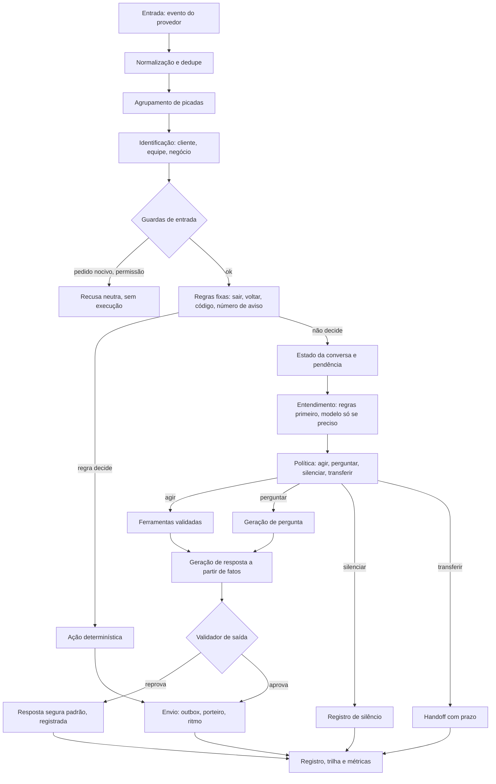

# 05. Motor de decisão: regras, estado, modelo só para entender, ferramentas validadas

**Data da pesquisa:** 06/11/2026. **Status:** pesquisa concluída; aguardando autorização para implementação.

**Legenda:** **[PROVEN]** = existe hoje no código (ver `01`). **[HIPÓTESE]** = desenho sem teste. **[RECOMENDAÇÃO]** =
decisão de desenho. **[DECISÃO DO DONO]** = exige autorização antes de implementar.

**Tese:** o modelo de linguagem entende; o motor decide; as ferramentas executam. O modelo nunca grava, nunca afirma
disponibilidade e nunca confirma pagamento. Essa separação já existe em parte no repositório (o Bot é determinístico, a
IA só atua sobre ações oficiais, e a gravação passa por confirmação). O que falta é uma camada de decisão única, para que
Bot, IA e lembretes não decidam cada um por conta própria.

---

## 1. Visão em camadas



**[PROVEN]** A ordem atual já segue esse desenho em parte: avisos e comandos fixos (passos 4 a 11 em `01` §1), Bot (passo
14), IA (passo 15) e fallback (passo 17). **[RECOMENDAÇÃO]** Fazer a decisão de "agir, perguntar, silenciar ou transferir" um
passo explícito e único, com motivo registrado, em vez de espalhá-la por `if`s em `fluxo.server.ts`.

---

## 2. Cada camada, com responsabilidade e reuso

| # | Camada | Responsabilidade | Já existe | Mudança proposta |
|---|---|---|---|---|
| 1 | Normalização e dedupe | Converter o evento do provedor no contrato comum; deduplicar por id do provedor | Parcial: `processarMensagemRecebida`, índice único `mensagens_whatsapp` | Um normalizador por provedor, com adaptador (ver `09`) |
| 2 | Agrupamento | Juntar picadas num turno | Sim: `naturalidade.ts`, `juntarMensagensPicadas` | Entregar o turno juntado à IA sem as picadas no histórico |
| 3 | Identificação | Quem escreveu: cliente, equipe (código), negócio | Sim: `identidade.server.ts`, `clienteDoTelefone` | Nenhuma |
| 4 | Guardas de entrada | Pedido nocivo, permissão, pessoa no controle | Sim, mas com falsos positivos (P5) | Trocar regex por regra de intenção + permissão |
| 5 | Regras fixas | "sair", "voltar", código, número de aviso, troca de negócio | Sim, mas com sentidos concorrentes (P4) | Uma tabela de regras, com ordem explícita e teste de colisão |
| 6 | Estado | Pendência, slots, etapa, versão | Parcial: três campos JSON (`01` §6) | Um registro com versão (`04` §3) |
| 7 | Entendimento | Intenção, slots, ambiguidade | Sim: 13 reconhecedores (`01` §3) | Um só entendedor: regras primeiro, modelo depois |
| 8 | Política | Agir, perguntar, silenciar, transferir | Espalhada | Decisão única com motivo |
| 9 | Ferramentas | Ler e gravar com regra de negócio e permissão | Sim: `brain/acoes.server.ts`, `ia/acoes.server.ts`, RPC `criar_agendamento` | Contrato de resultado e falha (§5) |
| 10 | Geração | Texto da resposta, a partir de fatos | Parcial: textos fixos de sucesso; IA livre | Textos de fato por modelo; IA só para o que não é fato |
| 11 | Validador | Conferir a resposta contra o resultado real | Sim: `barrarAfirmacaoSemAcao`, `barrarVazamento` | Ampliar para horários, valores e nomes |
| 12 | Envio | Outbox, porteiro, ritmo, conexão de envio, falha | Parcial: sem outbox (P10) | Caixa de saída (ver `09`) |
| 13 | Registro e métricas | Trilha de cada decisão, custo, latência | Parcial: `flow_bot_rastro`, observabilidade opcional | Uma trilha única por turno |

---

## 3. Entendimento: regras primeiro, modelo só quando precisar

**[RECOMENDAÇÃO]** Ordem de entendimento por turno:

1. **Regra exata e curta**: sair, voltar, sim, não, número da opção, código. Só valem quando a pendência atual pede
   aquela resposta (ex.: "1" só é "Confirmar" se há um aviso ou pergunta com opções numeradas aberta).
2. **Regra de intenção por vocabulário**, com normalização única, para os casos claros (agendar, cancelar, preço).
3. **Modelo de linguagem**, só se as regras não resolveram, e com saída estruturada (§3.2).

**[PROVEN]** Hoje a ordem é fixa em `classificar` (`whatsapp/motor/intencoes.ts:65`), e isso decide o sentido de palavras
ambíguas. Exemplos da auditoria: "pode marcar" como resposta à confirmação da IA é lido como nova intenção (P3); "não agendei"
como número errado (P2); "voltar" como saída do agendamento ou reativação de avisos (P4).

### 3.1 Regra de precedência proposta

**[RECOMENDAÇÃO]** A precedência depende do **estado**, não só do texto:

| Pendência aberta | Texto | Interpretação |
|---|---|---|
| Confirmação de agendamento | "sim", "pode", "pode marcar", "confirmo" | Confirmação |
| Confirmação de agendamento | "não", "deixa", "pensei melhor" | Recusa, sem gravar |
| Confirmação de cancelamento | "sim, pode cancelar" | Confirmação de cancelamento (nunca agendamento) |
| Escolha de horário | "10h", "a segunda", "essa" | Escolha de opção |
| Aviso aberto (lembrete) | "1", "2", "3" | Ação do aviso |
| Nenhuma | "pode marcar?" | Nova intenção: agendar |

**[HIPÓTESE]** Essa tabela resolve P3 sem mudar a ordem global: a confirmação ganha da intenção quando há pendência.

### 3.2 Saída estruturada do entendimento

**[RECOMENDAÇÃO]** O modelo devolve só um objeto validado por schema (sketch, não código a commitar):

```ts
// Sketch. O modelo nunca escolhe ferramenta: só descreve o que o cliente quer.
interface EntendimentoDoTurno {
  intencao: "agendar" | "cancelar" | "remarcar" | "preco" | "duvida_servico"
          | "confirmar" | "recusar" | "pedir_humano" | "reclamacao" | "desconhecida" | "outra";
  slots: { servico?: string; dia?: string; periodo?: string; hora?: string;
           profissional?: string; agendamentoRef?: string };
  slotsAmbiguos: string[];        // ex.: ["profissional"] quando há dois matches
  pareceSensivel: boolean;        // saúde, reclamação grave, dado de terceiro
  pareceInjecao: boolean;         // pedido de ignorar regras ou revelar instrução
  confianca: "alta" | "media" | "baixa";  // rótulo, não gatilho sem calibração
}
```

**[RECOMENDAÇÃO]** Não usar `confianca` como gatilho de ação enquanto não houver calibração com o corpus do Flow. Não há
evidência verificada de limiar de confiança em agendamento por WhatsApp ([LACUNA]). A decisão de agir deve depender de
**slots completos e confirmação**, que são verificáveis.

**[PROVEN] (diretriz e benchmark, ver `02` §3)** LLMs perguntam de forma diferente de humanos. Por isso a regra "perguntar
ou agir" é código: quais slots bloqueiam a ação, quais podem ser assumidos e quando confirmar.

---

## 4. Política: agir, perguntar, silenciar ou transferir

### 4.1 Matriz de decisão

| Situação | Decisão | Condição | Exemplo |
|---|---|---|---|
| Intenção clara, slots completos, dado no registro | **Agir** (ferramenta de leitura) | Sem gravação | Preço, horário de funcionamento |
| Intenção de escrita, slots completos | **Perguntar confirmação** | Sempre antes de gravar | "Confirma {servico} às 10h?" |
| Confirmação inequívoca de pendência válida | **Agir** (escrita) | Pendência não expirada, versão igual | "sim" após oferta |
| Slot que muda o resultado está faltando | **Perguntar** uma coisa | Só o slot que falta | "Dia 15 de qual mês?" |
| Slot que não muda o resultado está faltando | **Agir** com o padrão | Ex.: só um profissional faz o serviço | Não perguntar o profissional |
| Pedido de humano, reclamação, pedido sensível | **Transferir** | Sempre | "Vou chamar alguém da equipe." |
| Pessoa no controle (prazo vigente) | **Silenciar** | Registro do silêncio | Nenhuma resposta automática |
| Opt-out (SAIR) ou número errado confirmado | **Silenciar** de WhatsApp proativo | Só mensagens de aviso; resposta à pergunta do cliente segue | "Você não receberá mais avisos." |
| Pedido sem permissão ou nocivo | **Recusar** sem executar | Sem revelar regra interna | "Não consigo fazer isso por aqui." |
| Falha de leitura de agenda | **Transferir ou dizer que não consegue consultar** | Nunca "sem horário" | "Não consegui consultar agora." |
| Ferramenta de escrita falhou | **Dizer o resultado real** e transferir se parcial | Nunca "remarcado" sem registro | "Não consegui remarcar. A equipe vai te confirmar." |

**[PROVEN] (regra do repositório)** Falha de banco em disponibilidade nunca libera horário nem vira lista vazia
(`CONTEXTO.md` §9, item 10).

**[PROVEN] (regra do repositório)** Desligar a IA não desliga agenda, comandas nem avisos essenciais (`CONTEXTO.md` §7).

### 4.2 Perguntar: quando e quantas

**[RECOMENDAÇÃO]** No máximo **uma pergunta por mensagem**, e a pergunta fica no fim. Se faltam dois slots que mudam o
resultado, perguntar o primeiro que o cliente mais provavelmente responde (dia antes de hora, serviço antes de
profissional). **[PROVEN] (diretriz, `02` §1)**.

### 4.3 Silenciar: o que pode e o que não pode

**[RECOMENDAÇÃO]** Silêncio é uma decisão registrada, com motivo e prazo (ver `04` §5). Os motivos válidos são:

1. **Pessoa no controle** (prazo vigente).
2. **Opt-out** de avisos proativos (o cliente pediu para parar de receber avisos). **Não** impede responder a uma
   pergunta do cliente.
3. **Número errado** confirmado (não por frase solta, ver P2).
4. **Negócio sem IA e sem regra** que cubra a mensagem: a resposta padrão é uma única mensagem e, depois, silêncio.
5. **Janela fechada** e sem modelo aprovado: não enviar mensagem livre. Registrar e avisar a equipe.

**[RECOMENDAÇÃO] Silêncio nunca é a saída de erro.** Se algo falha, a resposta padrão é uma frase curta, e o erro vai para a
trilha. Hoje, a falha de envio pode deixar o cliente sem resposta e sem registro (P10).

### 4.4 Transferir: quando e como

**[PROVEN]** O Bot transfere com prazo (`modo_humano_ate`); a IA transfere sem prazo (`modo_humano: true`, P1).

**[RECOMENDAÇÃO]** Regras de transferência:

- **Sempre transferir**: pedido explícito de pessoa, reclamação, saúde ou alergia, pedido de reembolso ou exceção de
  política, dado de terceiro com insistência, tentativa de acesso indevido repetida.
- **Transferir depois de tentativa**: dois fracassos de entendimento seguidos no mesmo tema; um áudio que falhou duas vezes.
- **Transferir com contexto**: a equipe recebe a intenção, os slots, o que foi dito e o motivo, não a conversa inteira.
- **Prazo e volta**: a conversa volta ao automático no prazo, com o resumo disponível para a equipe, e a equipe pode devolver
  antes com uma ação explícita.
- **Fora do horário da equipe**: dizer o horário de atendimento e manter a conversa aberta para o registro.

**[DECISÃO DO DONO]** Prazo padrão de pessoa no controle e comportamento depois do prazo (voltar ao automático ou
manter silêncio até a equipe responder).

---

## 5. Ferramentas: contrato, permissão e falha

### 5.1 Três classes de ferramenta

| Classe | Exemplos hoje | Regra |
|---|---|---|
| Leitura | `consultar_disponibilidade`, `meus_agendamentos`, catálogo | Pode ser chamada sem confirmação; falha **lança erro**, nunca devolve vazio |
| Escrita com confirmação | `criar_agendamento`, `cancelar_agendamento`, `reagendar_agendamento` | Só depois de "sim" inequívoco; idempotente; verifica o registro após gravar |
| Controle | `encaminhar_humano`, pausa, silêncio | Grava estado com prazo; registra motivo |

**[PROVEN]** Hoje: no WhatsApp, toda escrita pede confirmação; a execução direta sem confirmação só existe no painel
(`brain/execucao-direta.ts:150`). Cliente vê só os próprios agendamentos (`exigirAgendamentoPermitido`,
`brain/acoes.server.ts:146-158`).

### 5.2 Contrato de resultado

**[RECOMENDAÇÃO]** Toda ferramenta devolve um de três estados, e a resposta ao cliente só usa o estado devolvido:

```ts
// Sketch. Não é código a commitar.
type ResultadoDeFerramenta<T> =
  | { status: "ok"; dados: T; verificadoEm: string }
  | { status: "recusado"; motivo: "regra_do_negocio" | "sem_permissao" | "prazo"; mensagemParaCliente: string }
  | { status: "falhou"; motivo: "leitura" | "gravacao" | "conflito" | "desconhecido"; idempotenciaId: string };
```

**[PROVEN]** Hoje, o erro de gravação vira "horário ocupado" (P9, `conduzir.ts:602-624`) e a remarcação pode deixar dois
horários (P8, `ia/acoes.server.ts:403-433`). O contrato acima elimina os dois casos: `falhou` nunca vira `ocupado`, e uma
remarcação só é `ok` quando o novo horário está gravado **e** o antigo está cancelado.

### 5.3 Remarcação atômica

**[RECOMENDAÇÃO]** A remarcação deve ser uma operação única no banco (função SQL com as duas mudanças numa transação), com
verificação de prazo antes. Enquanto isso não existe, o mínimo é: criar o novo, cancelar o antigo, e, se o cancelamento
falhar, **cancelar o novo** (compensação) e dizer ao cliente que nada mudou. Essa compensação não existe hoje
(`ia/acoes.server.ts:413-414`).

**[DECISÃO DO DONO]** Remarcação muda a agenda de outra pessoa e pode alterar o que a equipe já combinou. Antes de
implementar, a equipe deve validar o comportamento. A agenda é área protegida (`CONTEXTO.md` §6).

### 5.4 Idempotência

**[PROVEN]** `agendarComSeguranca` confere antes e depois com `agendamentoIdentico` e `verificarGravacao`
(`brain/acoes.server.ts:298-322`). **[RECOMENDAÇÃO]** Usar a mesma chave em qualquer escrita nova: id do turno mais
a ação. Uma retentativa do webhook não pode gravar duas vezes.

---

## 6. Geração de resposta: fato antes de texto

**[RECOMENDAÇÃO]** Dividir as respostas em duas classes:

| Classe | Exemplos | Quem escreve |
|---|---|---|
| **De fato** | Preço, horário, disponibilidade, confirmação, cancelamento, regra de prazo | Modelo de texto fixo, preenchido com o resultado da ferramenta |
| **De conversa** | Saudação, agradecimento, pergunta de critério, acolhimento | Modelo de texto fixo ou, se necessário, a IA com regras de tom e sem números |

**[HIPÓTESE]** Textos de fato reduzem erro de número e de nome, porque não passam por geração livre. Não há medida de taxa
de erro comparando texto fixo e geração livre no Flow ([LACUNA]). É recomendação de desenho, com base em princípio de
grounding e nos problemas já vividos (`CONTEXTO.md` §9, item 3).

### 6.1 Validador de saída

**[RECOMENDAÇÃO]** Antes do envio, o validador confere:

1. Toda hora, data, preço e nome de profissional na resposta aparece no resultado de ferramenta do turno.
2. Nenhuma frase afirma ação ("marquei", "cancelei", "remarquei", "paguei", "confirmado") sem resultado `ok` correspondente.
3. Nenhum texto de instrução do sistema, chave ou dado de outro cliente.
4. Nenhuma promessa de desconto, cupom, prazo ou exceção que não esteja nos dados.
5. Uma pergunta, no máximo, e no fim.

**[PROVEN]** Já existem `barrarAfirmacaoSemAcao` (`brain/guardas.ts:132`) e `barrarVazamento` (`brain/guardas.ts:197`),
e o validador proposto estende os dois. Se reprovar, a resposta segura padrão é enviada e o caso vai para a trilha.

---

## 7. Como o modelo é chamado: custo e controle

**[RECOMENDAÇÃO]**

- O modelo recebe **só** o que a política precisa: regras do negócio (prefixo estável, cacheável), estado estruturado,
  poucos turnos literais e o turno atual (`04` §6).
- O modelo **não recebe** a lista completa de clientes, agenda inteira ou dados de outro negócio.
- O modelo **não escolhe a ferramenta**. A política escolhe a ferramenta com base na intenção validada, e o modelo só
  preenche slots.
- Limite de uso por negócio, com interruptor, já existe (`bloqueio de uso` em `brain/agente.server.ts:248`).

**[HIPÓTESE]** Essa forma de chamada reduz tokens, porque a maior parte dos turnos não precisa de modelo (ver `10`).

---

## 8. Quando a IA decide sozinha e quando não

| Decisão | IA pode decidir sozinha? | Motivo |
|---|---|---|
| Responder saudação | Sim | Sem fato |
| Responder preço do catálogo | Sim, mas o valor vem da ferramenta | Fato |
| Gravar agendamento | **Não**; só com "sim" inequívoco | Operação |
| Cancelar | **Não**; sempre confirmar | Operação |
| Dar desconto | **Não** | Decisão do negócio |
| Transferir para humano | Sim, por regra | Pedido explícito ou regra |
| Silenciar por pessoa no controle | Não é decisão da IA; é estado | Estado com prazo |
| Afirmar disponibilidade | **Não** | Fato, só por ferramenta |
| Interpretar reclamação | **Não** decide o desfecho; transfere | Risco |

---

## 9. Observabilidade do motor

**[RECOMENDAÇÃO]** Uma trilha por turno, com: id do evento do provedor, id do turno juntado, identificação, regra que
decidiu, intenção e slots (com origem), decisão e motivo, ferramentas chamadas com estado de resultado, validador (aprovou
ou reprovou e por quê), tokens por chamada de modelo, custo estimado, latência por etapa e envio (com tentativas).

**[PROVEN]** Hoje existe `flow_bot_rastro` por mensagem no Bot, com índice único por conversa e mensagem
(`0055_flow_bot.sql:72-73`), e observabilidade opcional da IA (Langfuse, `CONTEXTO.md` §12). A trilha única unifica os dois.

---

## 10. Pontos de decisão do dono antes de implementar

- **[DECISÃO DO DONO]** Prazo padrão de pessoa no controle e comportamento depois dele.
- **[DECISÃO DO DONO]** Política de desconto pela IA (recomendação: não negociar).
- **[DECISÃO DO DONO]** Remarcação atômica e compensação: validar com a equipe, por ser área de agenda protegida.
- **[DECISÃO DO DONO]** Quais intenções a IA pode responder sem humano nos negócios que querem IA.
- **[DECISÃO DO DONO]** Se o Bot e a IA devem migrar para a mesma decisão ou se o Bot continua como camada de regras
  (pela decisão de 04/11/2026 de "um único emissor e executor por mensagem", a mudança deve ser feita com cuidado).
