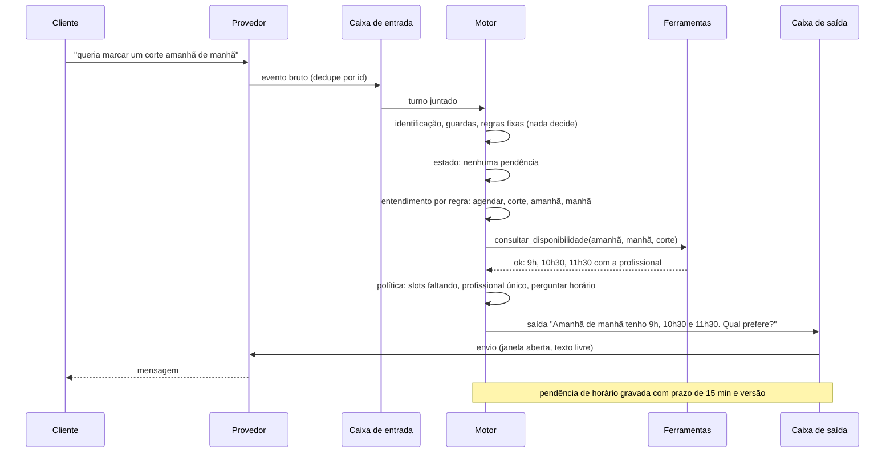

# 09. Arquitetura de referência proposta

**Data da pesquisa:** 06/11/2026. **Status:** pesquisa concluída; aguardando autorização para implementação.

**Legenda:** **[PROVEN]** = existe hoje no código (`01`). **[HIPÓTESE]** = desenho sem teste. **[RECOMENDAÇÃO]** = decisão
de arquitetura. **[DECISÃO DO DONO]** = exige autorização. Os blocos de tipo são **esboços de contrato**, para discussão.
Não são código para commitar.

**Restrições herdadas (não são negociáveis nesta proposta):** Bot primeiro e IA depois; um emissor e um executor por
mensagem; envio sempre pelo caminho oficial (porteiro, ritmo, janela de 24 h, falhas); dados pelo motor oficial de agenda;
liga e desliga por negócio, começando desligado; nada vai para a `main` nem para o site principal sem autorização
(`01` §12; `CONTEXTO.md` §8).

---

## 1. Visão geral

```mermaid
flowchart LR
    subgraph Entrada
        P1[Evolution: webhook] --> N1[Normalizador Evolution]
        P2[Meta: webhook] --> N2[Normalizador Meta]
        N1 --> CX[(Caixa de entrada: evento bruto)]
        N2 --> CX
    end

    subgraph Turno
        CX --> AG[Agrupamento de picadas]
        AG --> ID[Identificação: cliente, equipe, negócio]
        ID --> GU[Guardas de entrada]
        GU -->|bloqueio| REC[Recusa neutra]
        GU --> RG[Regras fixas]
        RG -->|decidiu| DEC
        RG -->|não decidiu| CT[Contexto: estado + histórico curto + dados do negócio]
        CT --> EN[Entendimento: regras, depois modelo]
        EN --> DEC[Política: agir, perguntar, silenciar, transferir]
    end

    subgraph Execução
        DEC -->|agir| TL[Ferramentas validadas]
        DEC -->|perguntar| GE[Geração]
        DEC -->|silenciar| SI[Registro de silêncio]
        DEC -->|transferir| HO[Handoff com prazo]
        TL --> GE
        GE --> VA[Validador de saída]
    end

    subgraph Saida
        VA -->|aprovada| CS[Caixa de saída]
        VA -->|reprovada| FB[Resposta segura]
        FB --> CS
        HO --> NO[Notificação à equipe]
        CS --> EN2[Envio: conexaoDeEnvio, porteiro, ritmo, janela]
        EN2 --> PR[Provedor]
        PR --> ST[Status de entrega]
    end

    subgraph Estado_e_trilha
        ST --> TR[(Trilha por turno)]
        DEC --> TR
        TL --> TR
        VA --> TR
        CT -.lê e grava.-> EST[(Estado da conversa, com versão)]
    end
```



**[RECOMENDAÇÃO]** Três mudanças estruturais em relação ao que existe hoje:

1. **Caixa de entrada durável para as duas portas.** Hoje só a Meta tem (`whatsapp_webhook_events`); a Evolution processa
   dentro da requisição (`evolution.ts:212`) (P18).
2. **Caixa de saída.** Hoje a resposta é síncrona e sem retentativa; uma falha depois de gravar a entrada perde a resposta (P10).
3. **Uma política de decisão explícita** (`05` §4), em vez de quatro caminhos com regras próprias.

---

## 2. Responsabilidades por etapa

| # | Etapa | Responsabilidade | Entrada | Saída | Onde no repositório (hoje) |
|---|---|---|---|---|---|
| 1 | Normalização | Converter o payload do provedor em `EventoDeEntrada` | Payload bruto | Evento padronizado | `evolution.ts`, `webhook.ts` (cada um por conta própria) |
| 2 | Caixa de entrada | Guardar o evento bruto antes de qualquer decisão; dedupe por `(conexao, idDoProvedor)` | Evento | Registro com estado `recebido` | Meta: `whatsapp_webhook_events`; Evolution: nada |
| 3 | Agrupamento | Juntar mensagens picadas num turno | Eventos da conversa dentro da janela | Turno juntado | `naturalidade.ts` (3 s, teto 8 s, 5 mensagens, 2 min) |
| 4 | Identificação | Quem escreveu e para qual negócio | Telefone, conexão | Cliente, equipe ou desconhecido; negócio | `identidade.server.ts`, `clienteDoTelefone`, `multi-barbearia.ts` |
| 5 | Guardas de entrada | Pedido nocivo, permissão | Turno | Liberado ou recusa | `brain/guardas.ts` (com falsos positivos, P5) |
| 6 | Regras fixas | Sair, voltar, código, número de aviso | Turno e pendência | Decisão ou "não decidiu" | `lembretes.server.ts`, `porteiro.ts`, `identidade.server.ts` |
| 7 | Contexto | Montar o que a decisão precisa: estado, histórico curto, regras do negócio | Conversa, negócio | Pacote de contexto | `responderComCerebro` (`fluxo.server.ts:1072-1130`) |
| 8 | Entendimento | Intenção e slots, com origem | Turno e contexto | `EntendimentoDoTurno` | `classificar`, `entender`, `pensarCortai` (espalhados) |
| 9 | Estado | Ler e gravar a pendência com versão | Evento de decisão | Estado novo | Três campos JSON (`01` §6) |
| 10 | Política | Agir, perguntar, silenciar, transferir | Entendimento, estado, regras | Decisão com motivo | Espalhada (`conduzir.ts`, `bot.server.ts`, `fluxo.server.ts`) |
| 11 | Ferramentas | Ler e gravar com permissão e regra | Ação e parâmetros | Resultado tipado (`ok`, `recusado`, `falhou`) | `brain/acoes.server.ts`, `ia/acoes.server.ts` |
| 12 | Geração | Texto a partir de fatos; modelo só para o que não é fato | Decisão e resultados | Texto | Textos fixos e `pensarCortaiComTurno` |
| 13 | Validador | Conferir a resposta contra os resultados | Texto e resultados | Aprovado ou reprovado | `barrarAfirmacaoSemAcao`, `barrarVazamento` |
| 14 | Caixa de saída | Registrar a saída com id de idempotência antes de enviar | Saída aprovada | Registro `pendente` | Não existe (P10) |
| 15 | Envio | Remetente, finalidade, consentimento, porteiro, ritmo, janela, falha | Registro da saída | Estado de envio | `enviarPelaBarbearia`, `conexaoDeEnvio`, `decidirFormato` |
| 16 | Handoff | Transferir com prazo e avisar a equipe | Motivo | Estado `humano` e notificação | Bot (com prazo); IA e lembrete (sem prazo, P1) |
| 17 | Trilha e métricas | Registrar cada decisão, custo e latência | Todas as etapas | Linha por turno | `flow_bot_rastro` (só Bot); observabilidade opcional |

---

## 3. Contratos de dados (esboços)

### 3.1 Turno e decisão

```ts
// Esboço. Não é código a commitar.
interface TurnoDeConversa {
  turnoId: string;                // id estável do turno juntado
  conversaId: string;
  tenantId: string;
  eventosIds: string[];           // eventos que compõem o turno
  texto: string;                  // texto juntado, já normalizado sem perder o original
  textoOriginal: string[];        // picadas, para auditoria
  recebidoEm: string;
}

interface DecisaoDoTurno {
  turnoId: string;
  acao: "agir" | "perguntar" | "silenciar" | "transferir" | "recusar";
  motivo: string;                 // código estável, ex.: "pedido_humano", "slot_faltando:dia"
  regraAplicada: "fixa" | "estado" | "entendimento" | "politica";
  ferramentas: { nome: string; idempotenciaId: string; resultado: "ok" | "recusado" | "falhou" }[];
  proximaEtapa: string | null;
  decidiuEm: string;
}
```

### 3.2 Saída e envio

```ts
// Esboço.
interface SaidaPendente {
  saidaId: string;                // idempotência do envio
  conversaId: string;
  turnoId: string;
  conexaoId: string;              // conexaoDeEnvio, nunca escolhida na tela
  finalidade: "resposta" | "aviso_agendamento" | "lista_espera" | "equipe" | "outra";
  formato: "texto" | "interativo" | "modelo";
  corpo: string;
  status: "pendente" | "enviando" | "enviada" | "entregue" | "lida" | "falhou" | "descartada";
  tentativas: number;
  proximaTentativaEm: string | null;
  erroCodigo: string | null;      // passa por erros-meta.ts
  idDoProvedor: string | null;
}
```

**[RECOMENDAÇÃO]** A caixa de saída é o único caminho de envio. Quem decide, grava a saída e a caixa envia. Assim, falha de
envio nunca apaga a decisão, e a retentativa usa o mesmo `saidaId`. Hoje `enviarPelaBarbearia` grava a saída como `falhou` e
relança o erro (`fluxo.server.ts:421-426`), e a maioria dos chamadores engole a exceção.

### 3.3 Estado da conversa

Ver `04` §3 (esboço `EstadoDaConversa`, com `versao`, `modo`, `humanoAte`, `silencioAte` e `pendencia`).

### 3.4 Ferramentas

Ver `05` §5 (`ResultadoDeFerramenta<T>`).

---

## 4. Fluxo de um turno de agendamento (exemplo, cenário 4)



**[RECOMENDAÇÃO]** Gravar a pendência **antes** da saída, e só marcar a saída como `enviada` depois do provedor aceitar.
Se a saída falhar, a pendência continua e a caixa tenta de novo. Hoje o estado é gravado antes do envio
(`atender.server.ts:108`), mas sem caixa de saída, e a falha deixa o estado avançado (P6).

---

## 5. Provedores como adaptadores

**[RECOMENDAÇÃO]** Cada provedor implementa três funções e declara capacidades:

| Função | Evolution | Cloud API (Meta) |
|---|---|---|
| `normalizarEntrada(payload)` | Gateway, com validação de instância e segredo (`segredo-webhook.ts`) | Assinatura `X-Hub-Signature-256` e `whatsapp_webhook_events` |
| `enviar(saida)` | `/message/sendText` e similares | Graph API, com janela e template |
| `declararCapacidades()` | Sem janela/template (Baileys, **[HIPÓTESE]**); botões depende do gateway | Janela, template, botões, status |

**[RECOMENDAÇÃO]** Remover os `if (provedor === "evolution")` de dentro dos métodos (`gateway.server.ts`) e fazer a decisão
consultar `CapacidadesDoProvedor`. Quando um recurso não existe no provedor, a política escolhe outro formato antes de
tentar (ex.: sem botões, texto numerado; fora da janela, modelo).

**[PROVEN] (código)** `decidirFormato` já escolhe texto, interativo ou modelo conforme canal e janela
(`whatsapp/modelos.ts:60-72`). A extensão é mover a decisão para a política, e não duplicar a regra.

**[RECOMENDAÇÃO] Ordem de implementação dos adaptadores:** primeiro a Meta (caixa durável já existe), depois a Evolution
(ganha caixa de entrada). Um terceiro provedor só entra depois dos dois, com teste de consistência entre provedores (`11`).

---

## 6. Trilha, observabilidade e custo por conversa

**[RECOMENDAÇÃO]** Uma linha por turno com: `turnoId`, `conversaId`, `tenantId`, provedor, regra que decidiu, intenção,
slots com origem, decisão e motivo, ferramentas com resultado, validador (aprovou ou reprovou, e por quê), chamadas de modelo
com tokens e custo, latência por etapa, e envio com tentativas.

**[RECOMENDAÇÃO]** Métricas mínimas, por negócio e por dia:

| Métrica | Como medir |
|---|---|
| Taxa de turnos decididos por regra | Turnos com `regraAplicada` diferente de `entendimento` |
| Taxa de transferência | Decisões `transferir` / turnos |
| Taxa de silêncio por motivo | Decisões `silenciar` agrupadas por `motivo` |
| Taxa de resposta reprovada pelo validador | `VA` reprovada / saídas geradas |
| Falhas de ferramenta por tipo | `falhou` por `motivo` |
| Custo por conversa | Soma de custos de modelo e de envio por conversa |
| Latência do turno, p50 e p95 | Diferença entre `recebidoEm` e `enviada` |

**[HIPÓTESE]** Essas métricas dependem da trilha; sem ela, a bateria de testes (`11`) mede só o que foi testado, e não o
que acontece em produção.

**[LACUNA]** Limite de duração de requisição e de CPU no Worker não foi consultado. A latência real não foi medida.

---

## 7. Transferência para humano

**[RECOMENDAÇÃO]** A transferência é uma decisão da política (`05` §4.4), com estado próprio:

- Grava `humano` com `humanoAte`, no fuso do negócio.
- Cria notificação para a equipe com o resumo (intenção, slots, último texto do cliente, motivo).
- Envia uma única mensagem de confirmação ao cliente.
- Silencia o automático até `humanoAte`.
- Ao expirar, volta ao automático e registra a volta.
- A equipe pode devolver antes por ação explícita.

**[PROVEN]** O Bot já grava `modo_humano_ate` e cria notificação `whatsapp_humano` (`bot.server.ts`, `prazoDoHumano`).
A IA não tem prazo (P1). A proposta usa **um** caminho para os dois.

---

## 8. Mudanças de banco: acréscimo somente, com autorização

**[RECOMENDAÇÃO]** As mudanças de banco propostas são **aditivas**. Nenhuma migração é aplicada sem autorização do dono
(`CONTEXTO.md` §8).

| Estrutura | Tipo | Observação |
|---|---|---|
| Estado da conversa com `versao` | Colunas novas em `conversas_whatsapp` ou tabela nova | Ler `0055` antes: `modo_humano_ate` pode não estar aplicada no `cortai-prod` |
| Caixa de entrada para a Evolution | Tabela nova análoga a `whatsapp_webhook_events` | Dedupe por `(conexao, idDoProvedor)` |
| Caixa de saída | Tabela nova `whatsapp_saidas` | Índice único por `idempotenciaId` |
| Trilha por turno | Tabela nova | Retenção definida pelo negócio |
| Políticas de prazo | Tabela pequena ou constante versionada | Uma fonte para os prazos (`04` §5) |

**[RECOMENDAÇÃO]** Antes de qualquer migração: ensaiar no banco local descartável (`supabase/baseline/ensaio/ensaio-local.sh`),
com testes em `supabase/tests`, e registrar o número da migração na reserva do diário. Hoje a migração mais alta é a `0059`
(`atendimento_ocorrencias`), aplicada só na prévia.

**[RECOMENDAÇÃO]** Função SQL de remarcação atômica: partir da versão de maior número que define a função, e comparar por diff
(`CONTEXTO.md` §9, item 1).

---

## 9. Pontos de integração com o que já existe

| O que muda | O que permanece |
|---|---|
| Entrada passa pela caixa durável | Webhook da Meta, validação de instância da Evolution |
| Decisão em uma função | Bot (regras), IA (entendimento), ferramentas oficiais |
| Saída em caixa | `enviarPelaBarbearia` vira o executor da caixa, com a mesma barreira de consentimento |
| Estado com versão | Campos atuais, lidos e migrados sem perda |
| Textos de fato | Textos fixos já existentes (`TEXTOS`) |
| Validador | `barrarAfirmacaoSemAcao`, `barrarVazamento` |

**[RECOMENDAÇÃO]** Nada disso remove o Flow Bot nem a Flow IA. A proposta muda **quem decide** e **como a saída chega ao
cliente**, e mantém as regras e as ferramentas.

---

## 10. Riscos da arquitetura

| Risco | Mitigação | Estado |
|---|---|---|
| Duas decisões concorrentes (Bot e política) | Migração gradual: a política primeiro em sombra, depois ligada | [RECOMENDAÇÃO] |
| Caixa de saída atrasa a resposta | Envio imediato na mesma execução, com caixa só para falha e retentativa | [HIPÓTESE] |
| Duplicar mensagem na retentativa | `idempotenciaId` no provedor, quando suportado; senão, registro antes do envio | [HIPÓTESE] |
| Migração de estado perde pendências | Migração aditiva, com leitura dos dois formatos durante a transição | [RECOMENDAÇÃO] |
| Regra de consentimento contornada | Finalidade obrigatória na saída e teste de cobertura de todo caminho de envio | [PROVEN] (barreira existe) |
| Mudança na Agenda | Remarcação atômica toca a agenda: validar com a equipe antes | [DECISÃO DO DONO] |

---

## 11. Lista de cenários de referência

Os 20 cenários do brief estão em `03-casos-de-atendimento.md` (seção 3). Esta arquitetura referencia cada um pelo número:

| Cenário | Etapas da arquitetura que mais pesam |
|---|---|
| 1 Primeiro contato | Regras fixas, contexto (horário), política (responder) |
| 2 Preço | Entendimento, ferramenta de catálogo, validador de valor |
| 3 Dúvida de serviço | Entendimento, catálogo; política transfere se saúde |
| 4 Agendamento simples | Ferramenta de disponibilidade, estado com versão, confirmação |
| 5 Profissional | Entendimento com slot ambíguo, ferramenta de profissionais |
| 6 Sem horário | Ferramenta com falha distinta de vazio |
| 7 Indeciso | Política (uma pergunta de critério), estado com prazo |
| 8 Duas mensagens | Agrupamento, histórico sem picadas |
| 9 Áudio | Caixa de entrada com baixa de mídia no prazo, transcrição |
| 10 Cancelamento | Ferramenta de posse e prazo, confirmação |
| 11 Remarcação | Ferramenta atômica, prazo |
| 12 Muda de ideia | Estado: desistência sem gravação |
| 13 Reclamação | Política: transferir sempre |
| 14 Desconto | Política com regra do negócio |
| 15 Quer humano | Handoff com prazo |
| 16 Retorna após dias | Estado e memória com validade |
| 17 Recorrente | Padrão comprovado como proposta |
| 18 Ambígua | Entendimento, pergunta única |
| 19 Não responde | Estado expirado, caixa para retomada |
| 20 Sem autorização | Guarda de entrada e recusa neutra |

---

## 12. Decisões do dono antes de implementar

- **[DECISÃO DO DONO]** Ordem de migração: sombra da nova política antes de ligar.
- **[DECISÃO DO DONO]** Mudança em remarcação atômica (área de agenda).
- **[DECISÃO DO DONO]** Baileys em produção ou Cloud API como padrão (`08` §2).
- **[DECISÃO DO DONO]** Retenção de áudio, imagem e trilha.
