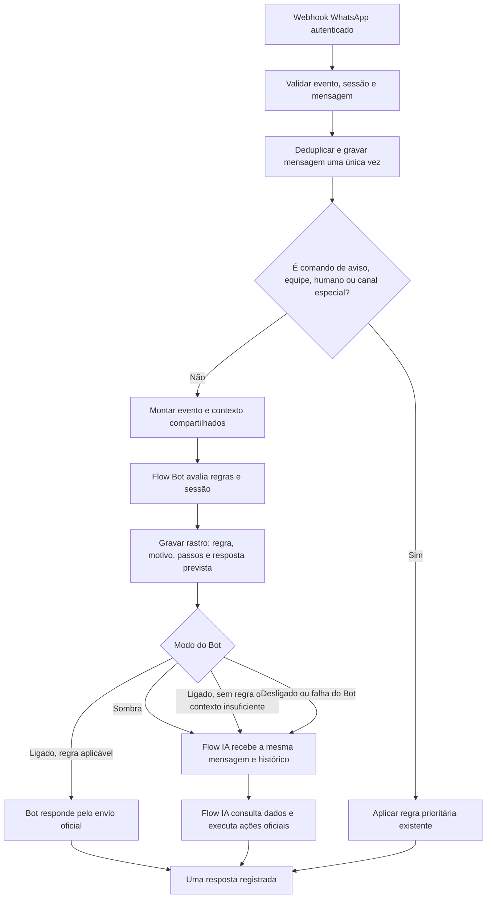

# Fluxo cooperativo — Flow Bot + Flow IA

**Estado:** decisão do dono em 04/11/2026.  
**Escopo:** atendimento recebido pelo WhatsApp; sem novo servidor, sem segundo cérebro e sem alteração do motor copiado do Flow Bot.

## Objetivo

Cada mensagem elegível do cliente alimenta os dois sistemas com o mesmo evento e o mesmo contexto do negócio. O Flow Bot aprende quais regras seriam aplicáveis; a Flow IA continua garantindo o atendimento completo. A arquitetura mantém **um único emissor e um único executor de ações por mensagem**.

"Alimentar simultaneamente" significa que os dois recebem a mesma entrada conversacional e compartilham o histórico persistido. A execução é deliberadamente coordenada, não duas execuções completas concorrentes: `pensarCortai` pode preparar e executar ações de domínio e consumir uma ação pendente. Rodar o cérebro completo em paralelo com o Bot poderia executar uma ação mesmo quando a resposta do Bot fosse escolhida.

## Fluxo de entrada

## Modos operacionais

### 1. Desligado (padrão)

O Bot não interfere. A Flow IA segue o fluxo atual. Esse é o estado inicial de cada negócio.

### 2. Sombra — piloto cooperativo

- O Bot recebe o texto, a identificação da conversa e os fatos oficiais do negócio.
- Executa o fluxo publicado/modelo padrão sem enviar mensagem.
- Grava no `flow_bot_rastro` o modo, a versão, o motivo, os passos, as respostas previstas e os fatos ausentes.
- Retorna o controle ao fluxo normal; a Flow IA responde ao cliente e continua podendo consultar agenda, preparar agendamento e executar as ações permitidas após confirmação.
- A mensagem e a resposta real ficam no histórico compartilhado em `mensagens_whatsapp`.

**Resultado:** o cliente é atendido pela Flow IA; o Bot é avaliado com as mesmas mensagens, sem competir pelo envio.

### 3. Ligado — atendimento híbrido com fallback

- O Bot avalia primeiro.
- Se produzir uma resposta determinística completa, envia pelo caminho oficial do Flow e encerra o turno automático.
- Se não encontrar regra, faltar fato necessário, ocorrer falha recuperável ou não houver resposta útil, devolve o controle à Flow IA.
- Se a pessoa pedir atendimento humano, aciona o modo humano e não deixa a Flow IA responder por cima.
- Se o Bot estiver desligado ou ainda não houver a migração/tabelas, a mensagem continua para a Flow IA como hoje.

**Resultado:** Bot cuida do que sabe responder com regra validada; Flow IA cobre o restante.

## Regras de arbitragem e segurança

1. **Prioridade antes dos motores:** deduplicação, respostas a avisos (1/2/3, SAIR, VOLTAR e códigos), canal de notificações, equipe verificada e modo humano são tratados antes do Bot.
2. **Um evento, uma gravação:** usar o ID externo da mensagem para idempotência; não criar uma segunda mensagem para alimentar a IA.
3. **Um emissor:** nenhuma chamada paralela de envio pelo Bot e pela IA. Todo envio do Bot passa por `enviarPelaBarbearia`, conexão principal, porteiro, ritmo, formato e tratamento de falhas existentes.
4. **Ações só pelas funções oficiais do cérebro:** agendar, remarcar e cancelar usam sempre as ações de `src/lib/brain/acoes.server.ts` (disponibilidade real, regras da agenda, idempotência, conferência do que foi gravado, prazo de cancelamento). **Atualizado pelo dono em 05/11/2026:** com o Bot **ligado**, o agendamento na conversa (`src/lib/flow-bot/agenda-na-conversa/`) conduz essas ações sem IA — pergunta o que falta, oferece horários livres reais e só grava depois do "sim" do cliente. Ao responder, descarta a ação pendente da Flow IA naquela conversa. Em **sombra** ele não roda, porque grava na agenda. Nenhum caminho novo de gravação: só as ações do cérebro.
5. **Sem concorrência entre executores:** não chamar `pensarCortai` em paralelo com o Bot. O cérebro pode executar ações e consumir uma confirmação pendente; a resposta do Bot não pode cancelar nem duplicar esse efeito.
6. **Falha não bloqueia:** falha ao ler configuração, compilar ou executar o Bot deve devolver o turno à Flow IA; falha do Bot não pode impedir o atendimento.
7. **Sem regra não é erro:** ausência de correspondência, realidade incompleta ou conhecimento ainda não cadastrado encaminha para a Flow IA. Não enviar menu genérico antes dela.
8. **Pessoa no controle:** mensagem escrita pela equipe no próprio celular pausa os dois motores pelo prazo configurado. A mensagem da própria plataforma não pode ser confundida com uma resposta humana.
9. **Dados verdadeiros:** preços, horários, serviços, disponibilidade e endereço vêm das fontes oficiais do Flow. Nenhum motor pode inventar esses fatos.
10. **Sem aprendizado automático em produção:** a IA pode resolver a pergunta que o Bot não cobriu, mas não publica regra nem altera o fluxo sozinha. Perguntas sem resposta viram material de diagnóstico/proposta. Uma nova regra só entra após revisão do dono, nova versão e testes de ouro.

## Como a conversa alimenta os dois

| Entrada/evento | Flow Bot | Flow IA |
|---|---|---|
| Mensagem recebida | Avalia gatilhos, estado e fatos; grava rastro | Recebe mensagem e histórico; responde no modo sombra ou quando o Bot não atende |
| Bot reconhece regra | Registra previsão; no modo ligado pode responder | No modo sombra é a resposta real; no modo ligado não executa o mesmo turno |
| Bot não reconhece regra | Registra ausência de correspondência/fato | Assume o turno, consulta o cérebro e responde |
| Cliente corrige ou continua | Próxima mensagem alimenta a sessão do Bot | Histórico compartilhado mantém contexto e pendências oficiais |
| Humano assume | Fica em silêncio | Fica em silêncio |
| Correção do dono | Nova versão do fluxo, anterior preservada | Pode ajudar a diagnosticar e propor a correção; não publica sozinho |

## Piloto recomendado

1. Escolher um negócio piloto e manter o Bot em **sombra** por 7 dias.
2. Comparar perguntas recebidas, regras previstas pelo Bot, respostas reais da Flow IA e perguntas não cobertas. A comparação deve usar dados minimizados; não criar cópia desnecessária de telefones ou mensagens pessoais.
3. Ajustar regras com o dono, publicar nova versão e rodar os testes de ouro.
4. Ligar o modo híbrido somente para o negócio piloto; manter os demais desligados.
5. Acompanhar erros de correspondência, fatos ausentes, falhas de envio, pedidos de humano e casos em que o Bot deveria ter encaminhado à IA. Desligar o Bot do negócio se houver resposta incorreta.

## Limites desta decisão

- Não cria uma segunda IA, um serviço separado, fine-tuning ou aprendizado autônomo.
- Não autoriza aplicar a migração 0055 em banco real ou de prévia.
- Não autoriza ativar o Bot em nenhum negócio.
- Não altera configuração de planos, custos, provedor de IA, política de WhatsApp ou mensagens sistêmicas.
- A tela de configuração e o painel administrativo continuam fora da Fase A.

## Estado técnico confirmado na branch em 04/11/2026

O fluxo atual já implementa a base deste contrato: `fluxo.server.ts` chama o Bot antes do cérebro; no modo `sombra`, o Bot registra e devolve o turno para a Flow IA; no modo `ligado`, ausência de texto útil devolve o turno à IA; e o envio do Bot usa `enviarPelaBarbearia`. A próxima validação técnica da Fase A é testar o orquestrador com banco falso nos cenários registrados no `DIARIO.md`.

**Sem regra (05/11):** quando o motor só entra pela entrada genérica (`trigger.message_received`, saudação com menu), `semRegraReconhecida` marca o rastro como `sem_regra`, sem resposta prevista, e o turno vai para a Flow IA nos dois modos; o menu nunca é enviado nem fica como pergunta em aberto. Testes: `src/lib/flow-bot/bot.server.test.ts`.

**Importante:** o modo sombra ainda não está ativo para os negócios por padrão. A migration 0055 permanece não aplicada, e este documento não representa ativação em WhatsApp real.
